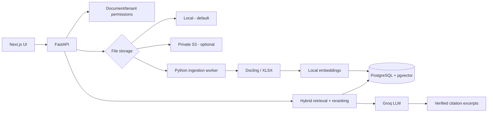

# Asteria Studio — Enterprise Knowledge Intelligence Platform

**Evidence-grounded, permission-aware RAG for luxury hospitality architecture and interior design.**
*Fictional US design-consultancy scenario with synthetic project documentation. Business-model references are not clients.*

## The problem

Hotel renovation teams must cross-reference finish approval memos, supplier bids, fire-documentation registers, project briefs and historical renovation records. Information is fragmented across DOCX, PDF and XLSX documents; different departments have different access rights. General-purpose LLM chat cannot enforce project permissions or prove where an answer came from.

## What this implementation demonstrates

- **Document intelligence:** upload, validate, deduplicate and queue documents; worker parses PDF/DOCX with Docling and XLSX using spreadsheet extraction; indexed text retains source metadata.
- **Hybrid retrieval:** SQL full-text + pgvector similarity → reciprocal rank fusion → cross-encoder reranking.
- **Grounded generation:** Groq structured answers with source-backed citation excerpts and safe abstentions; answer-level correctness remains imperfect in pilot tests.
- **Access controls:** API/backend tenant and document grants, with six simulated demo users. **Development identities are not secure production authentication.**
- **Storage:** local filesystem by default; optional private S3 original-document storage via Boto3 (live account integration requires verification).
- **Presentation:** Next.js role-aware library, search and document upload workflows.
- **Engineering:** PostgreSQL migrations, Python tests, small pilot evaluation, Docker build configuration, GitHub Actions unit/build workflows (remote runs unverified). **Full container build and remote CI success not yet confirmed.**

## Architecture

See [actual component/data-flow diagrams](docs/ARCHITECTURE.md) and [optional AWS deployment concept](docs/ARCHITECTURE.md#optional-aws-deployment-concept--not-implemented-or-deployed). The AWS diagram is *planned deployment infrastructure*, not a running environment.



## Key technologies

Python 3.12 · Conda · FastAPI · SQLAlchemy · PostgreSQL/pgvector · Docling · Sentence Transformers · cross-encoder reranking · Groq · Next.js/TypeScript · pytest · Docker Compose (packaged) · GitHub Actions (configured) · Boto3 for optional S3.

## Quick start (Windows / local demo)

The baseline DB is started separately; full Docker images are not required for the local demo.

```cmd
conda activate docmind_env
cd /d F:\Github\enterprise-knowledge-intelligence
docker compose up -d db
cd backend
python -m uvicorn app.main:app --host 127.0.0.1 --port 8000
```

In another terminal:

```cmd
conda activate docmind_env
cd /d F:\Github\enterprise-knowledge-intelligence\backend
python -m app.worker
```

And another terminal:

```cmd
cd /d F:\Github\enterprise-knowledge-intelligence\frontend
npm ci
npm run dev
```

Open `http://localhost:3000`. Configure secrets using `backend/.env` and `frontend/.env.local` **locally** (never commit these). Use the existing environment example files as templates. See [S3 instructions](docs/S3_SETUP.md) to switch only new uploads to S3.

[Final Windows release commands](docs/RELEASE_COMMANDS.md).

## Demo scenario

Admin uploads an approved upholstery design memo, a fire-document register and supplier quotes for synthetic hospitality projects. A designer can search approved materials but does not receive procurement-only quotations. Procurement can access relevant pricing. A rival tenant cannot retrieve the design consultancy's records. [Demo script (3–5 min)](docs/DEMO_SCRIPT.md).

## Evaluation (small synthetic pilot; not production accuracy)

| Signal | Measured result | Limit |
|---|---:|---|
| Document Recall@5 (keyword/vector/hybrid) | 1.000 each | 3 documents, 12 answerable questions |
| MRR@5 keyword / vector / hybrid rerank | 0.889 / 0.635 / 0.833 | Hybrid did not exceed keyword |
| Hybrid retrieval p50 | 115.4 ms | warm local run only |
| Answer automatic rule pass | 10/15 (66.67%) | not audited faithfulness |
| Unauthorized source exposure | 0 in tested scenarios | simulated identities and small pilot |
| Latest reported backend unit suite | 33 passed, 1 skipped | prior to S3 patch; rerun locally |

See [evaluation methodology and caveats](docs/EVALUATION.md). Groq citation-format and timeout issues remain unresolved in the answer pipeline. This is a transparent engineering case study, not a production certification.

## Repository map

```text
backend/app/        FastAPI routes, storage, ingestion, retrieval, security
backend/migrations/ PostgreSQL and access-grant migrations
backend/evaluation/ Evaluations, case definitions and curated results
backend/tests/      Unit / contract / storage-adapter tests
backend/scripts/    Offline evaluation and optional S3 smoke
frontend/           Next.js application
samples/hospitality/ Synthetic DOCX/PDF/XLSX examples
docs/               Architecture, evaluation, demo and case study
.github/workflows/  Backend/frontend CI and storage tests
```

## Security and operating limitations

- `x-demo-user` and the development API key are demo-only; deploy publicly **only after adding real authentication and appropriate infrastructure security**.
- Tenant permission checks apply in the backend/database. S3 objects must remain private, not served directly to untrusted browsers.
- No real client, paid deployment, cloud-compute architecture, or AWS S3 live test is claimed unless separately evidenced.
- Supplier fire-submission records do not independently establish regulatory certification.
- PII redaction helper tests are limited; no end-to-end compliance guarantee.

## Portfolio case study

[Problem → approach → measured impact → engineering tradeoffs](docs/PORTFOLIO_CASE_STUDY.md).
