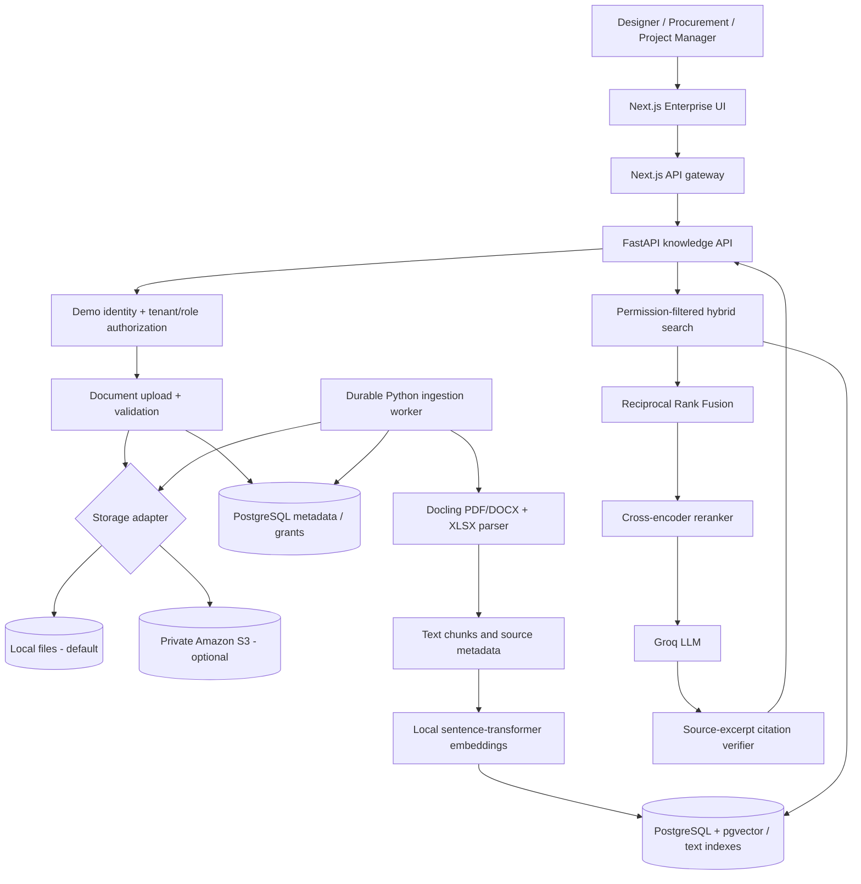
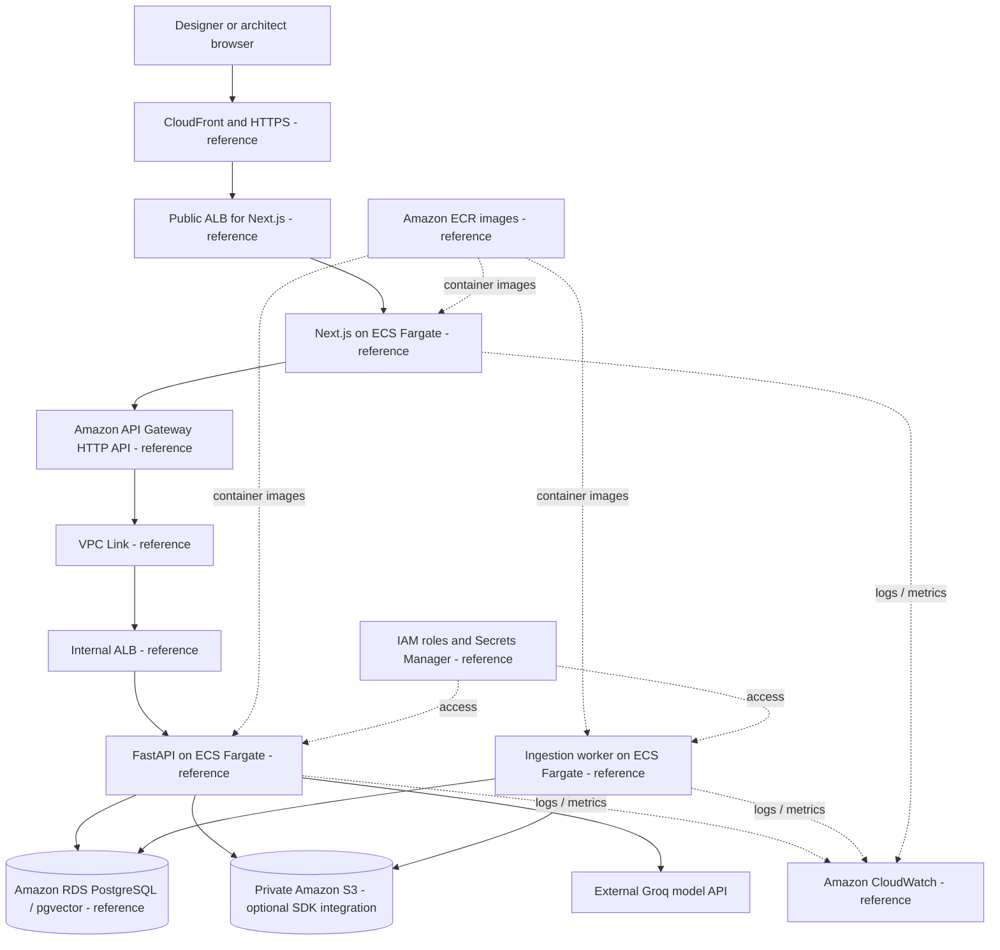

# Asteria Studio — Technical Architecture

**Business context:** Fictional US luxury-hospitality interior design and architecture consultancy. All sample projects and suppliers are synthetic. No connection to a real client is implied.

## Current code architecture: local-first, optional S3 storage

- **Local path:** existing local files, worker, and DB remain unchanged in behavior.
- **S3 path:** implemented by optional storage adapter + upload/worker integration in this release kit. The worker downloads S3 documents to a temporary file for the existing parser. This is **not** an AWS deployment.
- **Authorization:** the demo uses a development API key and simulated identities; not production authentication. Document grants, tenant filters, and access checks are enforced at API/database retrieval level, not via public S3 links. Bucket is private and access is server-side only.
- **Citation integrity:** source-excerpt matching is a syntactic/provenance check, not proof of semantic faithfulness. Answer-quality failures and timeouts remain in the pilot.
- **PII:** limited redaction-helper tests exist; comprehensive PII removal has not been validated in application logs or data lifecycle.

## Ingestion data flow

## Optional AWS reference deployment — NOT implemented or deployed

**This section is a design reference, not an account of deployed infrastructure.** The only AWS integration packaged by this release kit is optional S3 original-document storage via Boto3; even that needs a live account smoke test before being described as verified.

- API Gateway private ECS integration needs VPC Link and a supported private target such as an Application Load Balancer; it is **not** wired directly to a private FastAPI container.
- In ECS, an **application task role** would grant scoped S3 permissions; the **task execution role** would pull ECR images and send logs to CloudWatch.
- Private S3, RDS network restrictions, TLS, proper authentication, secret handling, logging hygiene, and cost controls require a separate deployment and security review.
- This project does **not** provision ECS, ECR, RDS, API Gateway, VPC Link, ALBs, CloudFront, Secrets Manager, IAM roles or CloudWatch. Those are architecture references only.

AWS technical references:
- https://docs.aws.amazon.com/apigateway/latest/developerguide/http-api-develop-integrations-private.html
- https://docs.aws.amazon.com/AmazonECS/latest/developerguide/security-iam-roles.html
