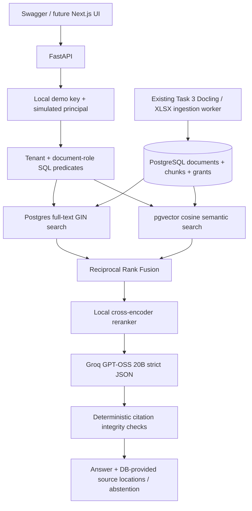

# Task 4 Architecture — Asteria Hospitality Studio (fictional)

**Trust boundary:** The `DEV` node is local-only simulation, not identity verification. Retrieval authorization must precede all model calls. SQL filtering is repeated on both retrieval branches; no candidate may bypass it.

**Future architecture:** Verified OIDC/JWT authentication + tenant membership claims, policy-based authorization and RLS defense in depth, malicious-document quarantine, PII-aware telemetry, observability, and signed source-document URLs.

**Project provenance:** Example luxury-hotel renovation data is synthetic, and the architecture is not associated with any real reference company.
